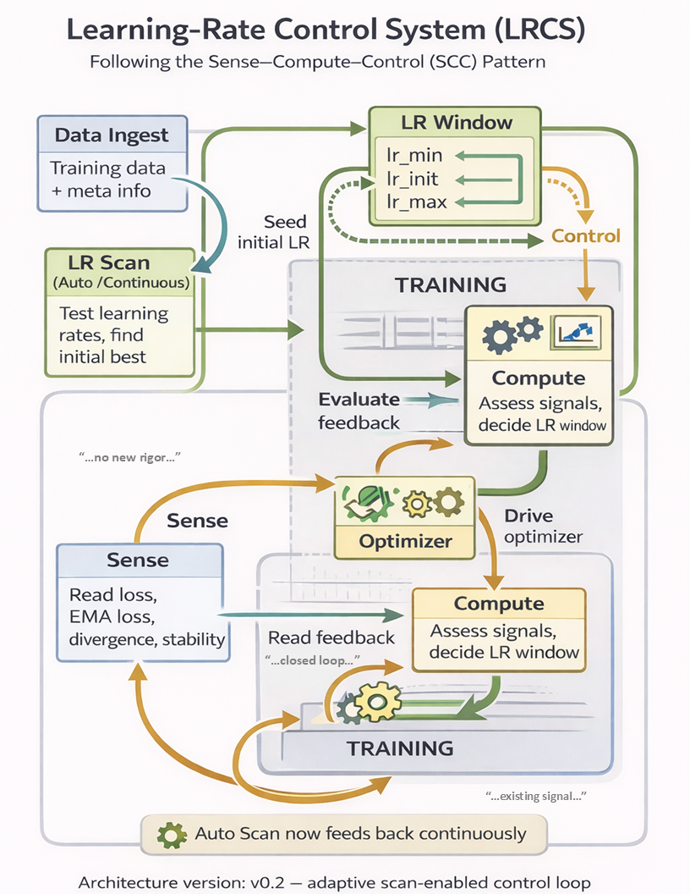
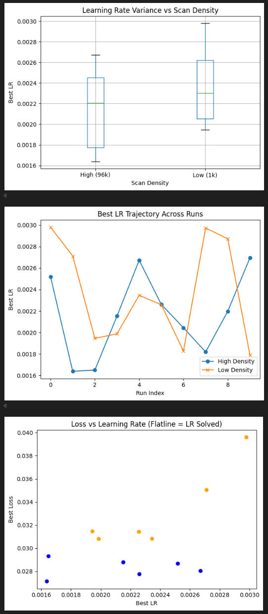
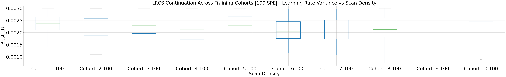
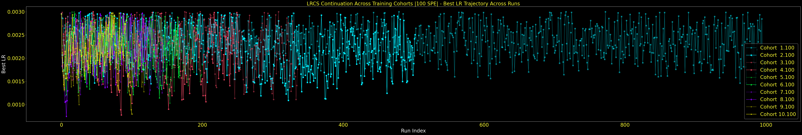
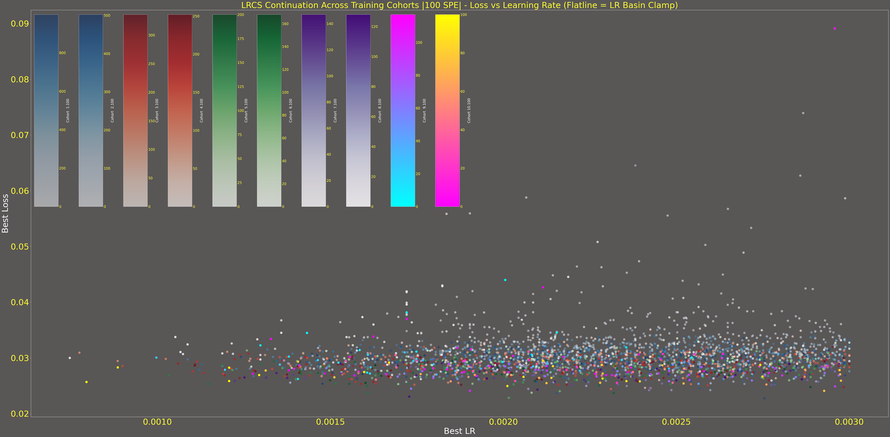
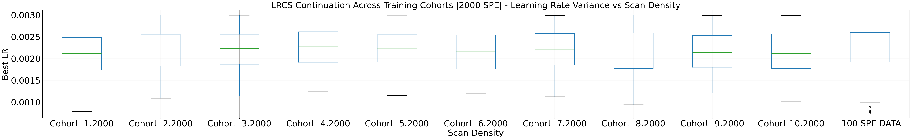
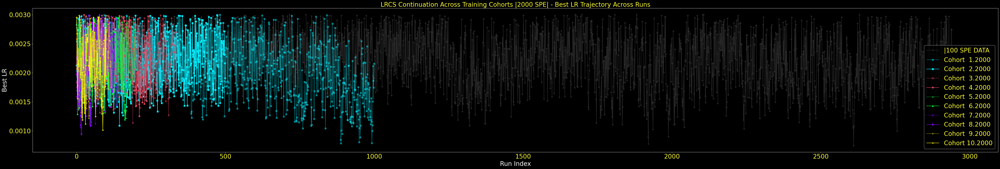
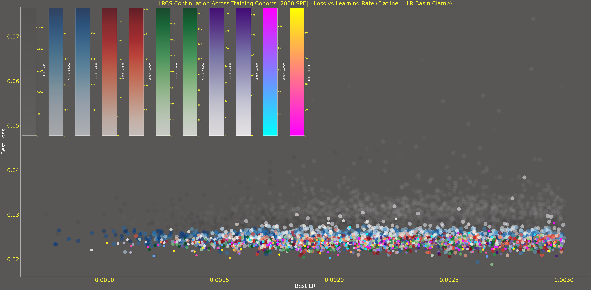

# Learning-Rate Control System (LRCS)

## Sneak Peek

Model training commonly begins with a learning rate selected before training starts. That value may later be tuned or scheduled, but the initial choice is often treated as configuration rather than as an ongoing systems question.

I began exploring a different possibility:

> What if learning-rate behavior observed during training could help shape what happens next?

That question led to the Learning-Rate Control System (LRCS), an engineering project that treats learning-rate behavior as part of a continuous feedback process.

This high-level architecture was developed during the earliest stage of the project. It describes a bounded control system in which training produces observable signals, those signals are evaluated, and the resulting decisions influence continued training.

The diagram intentionally shows the concept rather than the internal machinery. Its purpose is to make the system’s role visible: repeated observation and adjustment remain available throughout training while the engineer retains control.

## The first observations

The earliest experiments examined learning-rate behavior through three simple views:

- variation across learning-rate searches,
- movement across successive runs,
- and the relationship between learning rate and loss.

These early plots were limited in scale, but they exposed behavior that was difficult to ignore. Learning-rate results did not appear only as isolated tuning outcomes. Across repeated observations, they began to form trajectories and relationships that suggested the training process could be examined as a connected system.

The original loss-versus-learning-rate view described an emerging flat region as **“LR solved.”** That language reflected the resolution available at the time: a coarse interpretation of an interesting visual pattern and a reason to keep investigating.

## Revisiting the same questions

Later experiments returned to the same three views with substantially greater observational depth.

The following figures show continuation across ten training cohorts at **100 steps per epoch**.

At this resolution, progression was present but visually subtle. The trajectories can be read much like a seismograph: successive cohorts trace learning-rate movement across runs, while downward excursions expose access to lower-loss regions. In the scatter view, much of that movement remained compressed into a broad visual band.

The same investigation was then repeated at **2,000 steps per epoch**.

The deeper view makes the progression easier to resolve. The 100-SPE observations remain visible as a reference population, while the 2,000-SPE cohorts form a lower and tighter region beneath them.

What appeared comparatively flat at the earlier resolution becomes visibly progressive at the deeper one.

The modern scatter describes this region as an **“LR basin clamp.”** The change in language is intentional. “LR solved” was an early interpretation; “LR basin clamp” reflects a more detailed representation of the observed behavior.

The questions remained largely the same:

- How does learning-rate variation behave?
- How do learning-rate trajectories evolve?
- How does that evolution relate to loss?

What changed was the ability to observe those questions with greater precision.

---

LRCS remains an active engineering and research effort.

This Sneak Peek reveals the system’s high-level purpose and a small portion of its observed behavior. It does not describe the internal mechanisms that produce those results.

The intent is simpler:

> to show where the investigation began, how the evidence developed, and why the question remains worth pursuing.